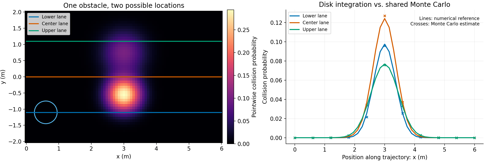

# 风险感知轨迹评估工具箱

**把障碍物的位置不确定性转成可检查的碰撞概率，再比较候选轨迹的风险。**

这是移动机器人规划工程中的基础风险评估模块。示例用一个具有两种可能位置的障碍物，展示三条候选轨迹如何穿过不同的风险区域；代码、场景和图片均可本地复现。



## 可以展示的能力

- **不确定性建模**：二维各向同性 Gaussian 与 Gaussian Mixture；一个障碍物的多个模式按混合权重相加。
- **几何概率计算**：计算圆盘内的位置概率，提供确定性数值积分与共享空间 Monte Carlo 两种实现。
- **轨迹风险比较**：输出逐位置风险曲线、峰值与均值，用相同空间采样比较候选路径。
- **可复现与边界检查**：固定随机种子，验证概率范围、覆盖几何、零命中处理、积分收敛和解析算例。

## 快速运行

Python 3.10 或更新版本。计算与测试仅依赖标准库：

```bash
python3 -m unittest discover -s tests -v
python3 demo.py --no-plot
```

生成风险热力图和曲线：

```bash
python3 -m venv .venv
source .venv/bin/activate
python -m pip install -r requirements.txt
python demo.py --output-dir outputs/demo --seed 721 --samples 20000
```

输出包含 `risk_demo.png`、`risk_demo.svg` 和 `risk_summary.json`。JSON 保存场景参数、候选坐标、逐位置积分参考值、Monte Carlo 估计和命中数。

本地已通过 7 项测试，并在 Python 3.10 / NumPy 1.26.4 / Matplotlib 3.8.4 下生成展示图；标准库运行方式也已单独验证。仓库中的 GitHub Actions 会运行测试和无绘图示例。

## 示例怎么读

左图颜色表示：机器人圆盘放在该位置时，与同一个不确定障碍物发生重叠的概率。两团高风险区域来自该障碍物的两种位置模式。右图比较三条等长轨迹：实线为数值积分参考，叉号为固定种子的 Monte Carlo 估计。蓝色圆圈标示碰撞半径的尺度。

这里评价的是**每个位置的碰撞概率**。曲线均值是路径评分，不能解释为整条轨迹的碰撞概率；多个时间点的事件通常相关。对多个物理障碍物使用 `independent_union_probability` 时，需要明确的独立性假设。

## 代码入口

| 文件 | 内容 |
|---|---|
| [`risk_validation.py`](risk_validation.py) | Gaussian/GMM、圆盘积分、共享 Monte Carlo 与独立事件组合 |
| [`demo.py`](demo.py) | 合成场景、候选轨迹评分、JSON 与图像生成 |
| [`tests/test_risk_validation.py`](tests/test_risk_validation.py) | 解析质量、平移一致性、采样复现与异常输入验证 |

当前范围是二维静态不确定位置下的轨迹评估，适合作为移动机器人规划器的基础组件与教学示例。有限采样可能产生超出概率范围的积分估计，代码保留这些结果并将其组合概率标为不可评估；零命中不意味着真实风险为零。数值积分是经过收敛检查的参考值，不是认证上界。

来源与依赖说明见 [`ATTRIBUTION.md`](ATTRIBUTION.md)。
